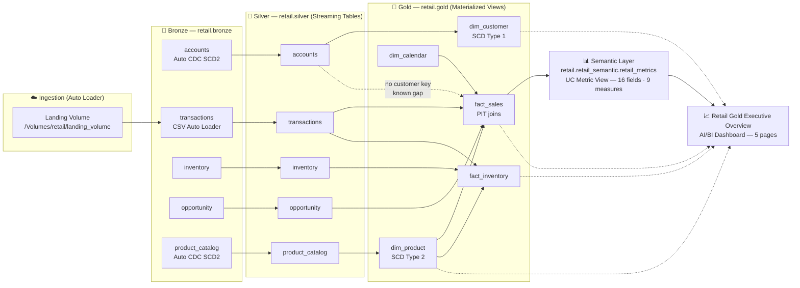

# 🛒 End-to-End Retail Analytics Platform

[](https://databricks.com)
[](https://aws.amazon.com)
[](https://docs.databricks.com)
[](LICENSE)

A complete **medallion-architecture retail data platform** built on Databricks (AWS, serverless compute + Photon): streaming bronze ingestion, declaratively-tested silver streaming tables, SCD-aware gold dimensional models, a Unity Catalog semantic metric layer, and an executive AI/BI dashboard.

---

## 📐 Architecture



---

## 🗂️ Project Structure

```text
dev_retail/
├── Retail_pipeline/                 # Lakeflow Spark Declarative Pipeline (serverless, Photon)
│   ├── silver/                      # One Python file per streaming table — latest state only
│   │   ├── accounts.py              #   Auto CDC SCD1 upserts on account_id
│   │   ├── transactions.py          #   Oracle string timestamps parsed, negatives dropped
│   │   ├── inventory.py             #   Trims locations, derives needs_restock
│   │   ├── opportunity.py           #   Salesforce-style pipeline data
│   │   └── product_catagory.py      #   Auto CDC → current product state (REPLACE USING)
│   ├── gold/                        # Materialized views for analyst consumption
│   │   ├── dim_product.py           #   SCD Type 2 (valid_from/valid_to/is_current)
│   │   ├── dim_customer.py          #   SCD Type 1
│   │   ├── dim_calander.py          #   Generated calendar 2025-01-01 → 2027-12-31
│   │   ├── fact_sales.py            #   Point-in-time join to dim_product + opportunity
│   │   └── fact_inventory.py         #   Stock value = quantity × unit price @ snapshot
│   └── explorations/
│       └── retail_metrics_metric_view.sql   # UC metric view definition (16 fields, 9 measures)
├── notebook/
│   └── blob_to_bronze_transaction    # Auto Loader: landing volume → retail.bronze.transactions
└── dashboard/
    └── Retail Gold Executive Overview.lvdash.json   # 5-page AI/BI executive dashboard
```

---

## 🥈 Silver Layer — Conventions

All silver datasets are **streaming tables** (no materialized views, no SCD history — latest state only), following a shared pattern:

* `clean_text` helper — trim + empty/whitespace → `NULL`
* `expect_or_fail` on primary keys · `expect_or_drop` for populated keys and non-negative numerics
* `delta.enableChangeDataFeed` enabled, liquid `cluster_by` on join keys
* Auto CDC sources read with `skipChangeCommits`, filtering out superseded rows (`__END_AT IS NOT NULL`)

| Dataset | Source | Pattern | Notes |
| --- | --- | --- | --- |
| `accounts` | `retail.bronze.accounts` | Auto CDC, REPLACE USING `account_id` | Sequenced by `system_modstamp` |
| `product_catalog` | `retail.bronze.product_catalog` | Auto CDC, REPLACE USING `product_id` | Sequenced by `source_updated_at` |
| `transactions` | `retail.bronze.transactions` | Append stream | Oracle `dd-MMM-yyyy hh.mm.ss a` timestamps; negative & null-key rows dropped; `net_amount = selling_price − discount_amount` |
| `opportunity` | `retail.bronze.opportunity` | Append stream | Empty Salesforce columns omitted; 3 negative `Amount` rows dropped |
| `inventory` | `retail.bronze.inventory` | Append stream | 40 rows; trailing spaces trimmed; derived `needs_restock` |

## 🥇 Gold Layer — Dimensional Model

| Table | Type | Built from | Description |
| --- | --- | --- | --- |
| `dim_product` | MV, **SCD Type 2** | bronze `product_catalog` | Surrogate key `md5(product_id\|valid_from)`, `valid_from`/`valid_to`/`is_current` from `__START_AT`/`__END_AT`; captures price-change history |
| `dim_customer` | MV, SCD Type 1 | silver `accounts` | `customer_id = account_id`, latest state only |
| `dim_calendar` | Generated MV | — | Fixed range 2025-01-01 → 2027-12-31 (1,096 rows), `date_key` as `yyyyMMdd INT` |
| `fact_sales` | MV | silver `transactions` | Point-in-time join to `dim_product` (handles pre-first-version prices), `dim_calendar` `date_key`, left join `silver.opportunity` on `opportunity_name` |
| `fact_inventory` | MV | silver `inventory` | Point-in-time `dim_product` join on `last_stock_update`; `stock_value = stock_quantity × unit_price_at_snapshot` |

## 📊 Semantic Layer

A Unity Catalog **metric view** — `retail.retail_semantic.retail_metrics` — standardizes KPIs with `MEASURE()` semantics across 16 dimensions (calendar, product, store, payment, channel, opportunity stage) and 9 measures:

| Measure | Measure |
| --- | --- |
| Transaction Count | Gross Sales |
| Total Units Sold | Total Discount |
| Net Revenue | Average Order Value |
| Discount Rate | Won Transaction Count |
| Distinct Products Sold | |

Validated: metric-view results match direct queries against `retail.gold.fact_sales` exactly. *(Known gap: `dim_customer` is not joined — `fact_sales` carries no customer key; upstream enrichment required.)*

## 📈 Executive Dashboard

**Retail Gold Executive Overview** — 5 canvas pages, 8 datasets (metric-view driven where possible, direct gold SQL otherwise):

| Page | Contents |
| --- | --- |
| Executive Summary | KPI counters, monthly net-revenue trend, category mix |
| Sales Deep Dive | Category/brand revenue, top-10 products, store performance, payment & channel mix |
| Opportunity Pipeline | Won rate, stage funnel, won-vs-lost by stage, stage detail table |
| Inventory Health | Stock value by category/brand/warehouse, below-reorder table |
| Products & Customers | SCD2 price history, launch scatter, active-status pie, customer segmentation |

Current snapshot: **$59.25M net revenue · 1,082 transactions · $54,761.30 AOV · 7.62% discount rate · 3,276 units · 162 won opportunities**.

---

## 🚀 Getting Started

1. **Ingest** — run `notebook/blob_to_bronze_transaction` to land CSV files from the volume into `retail.bronze.transactions` (Auto Loader with `trigger(availableNow=True)`).
2. **Process** — trigger an update of the **Retail_pipeline** (Lakeflow Spark Declarative Pipeline, serverless + Photon); it builds all silver streaming tables and gold materialized views and enforces data-quality expectations.
3. **Consume** — query the metric view `retail.retail_semantic.retail_metrics`, or open the dashboard `Retail Gold Executive Overview`.

## 🛠️ Tech Stack

* **Platform** — Databricks on AWS, serverless compute, Photon
* **Ingestion** — Auto Loader (cloud files), Auto CDC (SCD Type 2 in bronze)
* **Transformation** — Lakeflow Spark Declarative Pipelines (Python, one file per dataset)
* **Storage & governance** — Unity Catalog (`retail` catalog: `bronze` / `silver` / `gold` / `retail_semantic` schemas), Delta Lake with Change Data Feed and liquid clustering
* **Analytics** — UC metric views, AI/BI (Lakeview) dashboards

## 📄 License

This project is licensed under the Apache License 2.0 — see [LICENSE](LICENSE).
